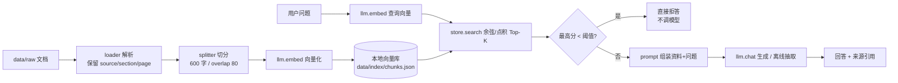

# RAG 企业知识库问答（初版 V1）

[](https://github.com/QinHuai00/rag-knowledge-base/actions/workflows/tests.yml)


> 一句话：把公司制度文档丢进去，用自然语言问，答案带原文引用；资料里没有的，直接说"没找到"。
> 这是求职项目里的**主力项目**的初版。当前版本故意做得"朴素但完整"：链路能跑通、指标能测、结论能复现，
> 后续优化路线（父子块 → BM25+RRF → Rerank → 工程化）见 [`docs/roadmap.md`](docs/roadmap.md)。

## 它现在能做什么

- 解析 Markdown / TXT / DOCX（装了 `pypdf` 还能解析 PDF），按标题切小节并保留来源
- 切分 → 向量化 → 本地向量库持久化（重启不丢）
- 问业务问题：召回 Top-K → 生成回答 → 标注 `[1][2]` 来源
- **低置信度直接拒答**：检索最高分低于阈值时不调用大模型，只说"知识库中未找到相关内容"
- 自带 24 条评测集：Recall@K、拒答正确率、可回答率、耗时一键跑
- 命令行 + 可选 FastAPI HTTP 服务 + 可选 Streamlit 页面

## 为什么这个初版值得看（工程取舍）

| 设计 | 原因 |
| --- | --- |
| **离线优先双模式** | 无 Key、无网络、不装第三方包也能跑通并评测；配好 `.env` 自动切真实模型，业务代码不动 |
| **拒答不调模型** | 检索最高分低于阈值时直接返回固定话术——省钱、快、且不可能编造 |
| **两套阈值分开** | 离线哈希点积是 4~30 量级、在线 BGE 余弦是 0~1 量级，混用必翻车，所以配置里分开并注明校准依据 |
| **评测先行** | 24 条标注集 + `eval/calibrate.py` 阈值扫描，改参数有数据可依，不靠感觉 |
| **可解释溯源** | 每个 chunk 带 `source/section/page`，回答引用能点回原文 |
| **索引原子写 + 一致性校验** | 写临时文件再 `os.replace`；打分方式与当前模式不一致时明确报错要求重建 |

## 快速开始（离线，不需要 API Key、不需要装任何包）

环境：Windows / Linux / macOS + Python 3.10+（开发环境 3.14）。在项目根目录执行：

```bash
git clone https://github.com/QinHuai00/rag-knowledge-base.git
cd rag-knowledge-base

# 1) 入库：解析 data/raw 下 3 份示例文档
python -m app.cli ingest --rebuild

# 2) 问答
python -m app.cli ask "试用期多久？"

# 3) 看评测指标
python -m app.cli eval
```

预期输出（节选）：

```text
[OFFLINE] 本地哈希向量 + 抽取式回答（配置 .env 后自动切换真实模型）
问题：试用期多久？
回答（offline-extractive）：
根据知识库资料：
- 试用期一般为 3 个月，劳动合同期限三年以上的岗位可约定 6 个月。 [1]
- 试用期工资为转正工资的 80%。 [1]
来源：
  [1] 员工手册.md · 1.2 试用期与转正（相似度 30.0623）
```

`[OFFLINE]` 是刻意加的：离线模式用**本地哈希向量 + 抽取式回答**跑到通为止，
它验证的是工程链路，**不代表真实语义检索效果**，所以不能用它的数字写简历。

### 离线模式是怎么工作的

| 环节 | 离线实现 | 在线实现 |
| --- | --- | --- |
| Embedding | 字符 2-3 gram 哈希到 2048 维 + IDF 加权 | BGE (`BAAI/bge-m3`) |
| 检索打分 | 查询单位向量 · 文档向量（IDF 点积） | 余弦相似度 |
| 回答 | 从命中原文摘句子 + 标引用 | 大模型按 Prompt 生成 |
| 拒答 | 最高分 < 阈值（默认 4.2） | 最高分 < 阈值（默认 0.30） |

## 接真实模型（改配置，不改代码）

```bash
# 1) 装依赖（建议用 venv/conda 隔离环境）
pip install openai python-dotenv numpy python-docx pypdf
# 需要 HTTP 服务再加：pip install fastapi "uvicorn[standard]" python-multipart

# 2) 复制并填写 .env
cp .env.example .env
```

`.env` 内容（以硅基流动为例，任何 OpenAI 兼容平台都行）：

```ini
SF_API_KEY=sk-你的key
SF_BASE_URL=https://api.siliconflow.cn/v1
CHAT_MODEL=Qwen/Qwen2.5-7B-Instruct
EMBED_MODEL=BAAI/bge-m3
```

```bash
# 3) 换模型必须重建索引（向量维度/空间都变了）
python -m app.cli ingest --rebuild
python -m app.cli ask "试用期多久？"
```

看到 `[ONLINE]` 就说明切到真实模型了。**在线模式一律用余弦 + BGE 阈值 0.30，
必须用你自己的评测集重跑 `eval/calibrate.py` 再定阈值**（见下文）。

## 架构



## 目录

```
rag-knowledge-base/
├─ app/
│  ├─ config.py       # 参数、模型名、两套阈值、可选依赖探测
│  ├─ llm.py          # Provider：在线 OpenAI 兼容 / 离线哈希向量 + 抽取式
│  ├─ loader.py       # 文档 → [Page]，Markdown 按标题切节
│  ├─ splitter.py     # 段落/句子优先的固定长度切分，保留偏移
│  ├─ store.py        # 向量库：JSON 持久化、打分、增量删除
│  ├─ retriever.py    # 检索 + 低置信度判断
│  ├─ prompt.py       # 抗幻觉 Prompt（三层防线的前两层）
│  ├─ generator.py    # 生成 / 抽取式降级 / 拒答
│  ├─ ingest.py       # 入库、内容哈希去重、IDF 统计
│  ├─ server.py       # FastAPI（可选依赖，缺库给提示）
│  └─ cli.py          # 命令行入口
├─ data/raw/          # 3 份示例制度文档
├─ data/index/        # 向量库产物（.gitignore）
├─ eval/              # qa_set.jsonl / run_eval.py / calibrate.py
├─ tests/             # 19 个 unittest 用例
├─ docs/roadmap.md    # 优化路线（V2 父子块 → V7 工程化）
├─ requirements.txt   # 真实模式依赖（全部可选）
├─ .env.example / .gitignore / .editorconfig
├─ .github/workflows/tests.yml  # CI：无依赖跑单测
├─ LICENSE / README.md
```

## 评测：数字是怎么来的

`eval/qa_set.jsonl` 手写了 24 条：20 条可回答（标了 gold_source 与答案要点）+ 4 条知识库里确实没有的。
`python -m app.cli eval` 输出（离线模式实测）：

| 指标 | 数值 | 说明 |
| --- | --- | --- |
| Recall@5 | **100.0%** | 正确来源文档出现在 Top-5；离线哈希偏字面匹配，在线模式需重测 |
| 可回答率 | 100.0% | 有答案的问题没有被误拒 |
| 拒答正确率 | 100.0% | 4 条"库里没有"的问题全部拒答 |
| 平均检索耗时 | 12.9 ms | 34 块的小库，仅作链路参考 |
| 平均端到端耗时 | 13.1 ms | 离线抽取式≈检索耗时；在线另有 TTFT |

> 这组数字**只说明链路正确**，不能证明检索质量。真实效果取决于 BGE + 你的语料，
> 请接入真实模型后用同一份评测集重跑，再把数字写进简历。

### 阈值不是拍脑袋定的

```bash
python -m app.cli eval        # 先看指标
python -m eval.calibrate      # 扫描阈值，看"可回答率 vs 拒答正确率"的权衡
```

离线实测分界：可回答题最低 4.66（"迟到怎么处理"），拒答题最高 3.86（"可以带宠物上班吗"），
所以默认阈值取 4.2。**换语料/换模型都要重跑校准**——这就是"阈值是数据定的，不是抄的"。

## HTTP 服务（可选）

```bash
pip install fastapi "uvicorn[standard]" python-multipart
python -m app.server        # http://127.0.0.1:8000/docs
```

- `GET /health`：块数 + 当前模式
- `POST /ingest`：上传文档入库（multipart）
- `POST /chat`：`{"question": "...", "top_k": 5}` → 回答 + 来源

## 已知局限（面试主动说，比被问出来强）

1. **初版切分是固定长度**：跨小节的长条款可能被切断。→ 优化 V2 换父子块。
2. **只有向量一路召回**：对 `HR-2024-07` 这类编号、专有名词不敏感。→ 优化 V3 加 BM25 + RRF。
3. **没有 Rerank**：Top-5 里可能混入弱相关块。→ 优化 V4 两阶段精排。
4. **离线模式不是语义检索**：哈希向量只能做字面近似，问题和原文用词差异大时会漏。
5. **没有多轮、没有权限过滤、没有流式**：初版只保证单轮问答可复现。
6. **增量入库后 IDF 会漂移**：新文档的新词用默认 IDF，要做严格实验请 `--rebuild`。

## 下一步

按 [`docs/roadmap.md`](docs/roadmap.md) 的 V2 → V7 逐级做：

- V2 父子块（预期 Recall@5 提升，答案完整度上升）
- V3 BM25 + RRF 混合召回（专有名词/编号问题显著改善）
- V4 Rerank 精排（Top-5 命中率再提一档）
- V5 查询改写、V6 生成侧校验、V7 增量/缓存/并发/SSE/Docker

每做完一级，把 `python -m app.cli eval` 的结果记进实验表——简历上的数字只能来自这张表。

## 许可证

MIT License，见 [LICENSE](LICENSE)。示例文档与数据均为虚构，可自由用于演示。
