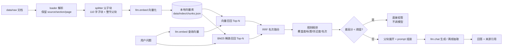

# RAG 企业知识库问答

[](https://github.com/QinHuai00/rag-knowledge-base/actions/workflows/tests.yml)


> 一句话：把公司制度文档丢进去，用自然语言问，答案带原文引用；资料里没有的，直接说"没找到"。
>
> 当前版本已完成 V1 → V4 优化：**父子块（small-to-big）→ BM25 + RRF 混合召回 → 规则精排**，
> 并升级了评测体系（Recall@K / MRR / nDCG / 要点覆盖率 / P95 延迟）与消融实验
> （`eval/ablation.py` 一键对比四级）。完整优化实录见
> [`eval/ablation.md`](eval/ablation.md) 与 [`docs/optimization-log.md`](docs/optimization-log.md)。

## 它现在能做什么

- 解析 Markdown / TXT / DOCX（装了 `pypdf` 还能解析 PDF），按标题切小节并保留来源
- **父子块切分**：110 字子块做检索（语义集中），整节父块喂给生成（上下文完整）
- **BM25 + RRF 混合召回**：向量召回与稀疏召回名次融合，对编号/专有名词更稳
- **规则精排**：覆盖度 / 小节标题 / 邻近度 / 原始名次四路打分，零依赖替代 cross-encoder
- 切分 → 向量化 → 本地向量库持久化（重启不丢）
- 问业务问题：召回 Top-K → 生成回答 → 标注 `[1][2]` 来源
- **低置信度直接拒答**：检索最高分低于阈值时不调用大模型，只说"知识库中未找到相关内容"
- 自带 53 条评测集：Recall@K / MRR / nDCG@5 / 要点覆盖率 / 拒答正确率 / P95 延迟
- 消融实验 `eval/ablation.py`：一键对比 V1/V2/V3/V4 并输出 Markdown 表
- 命令行 + 可选 FastAPI HTTP 服务 + 可选 Streamlit 页面

## 为什么值得看（工程取舍）

| 设计 | 原因 |
| --- | --- |
| **离线优先双模式** | 无 Key、无网络、不装第三方包也能跑通并评测；配好 `.env` 自动切真实模型，业务代码不动 |
| **父子块（small-to-big）** | 检索用小块拿精度、生成用整节拿完整性，避免"切太碎答案残缺" |
| **BM25 纯 Python 零依赖** | 不引 rank_bm25 / whoosh，自写 Okapi BM25 + 中文 2-gram，任何环境都能跑 |
| **RRF 融合而非加权平均** | 向量分与 BM25 分不同量纲，RRF 只用名次，省掉归一化这个超参 |
| **规则精排替代 cross-encoder** | 无 GPU/无重排模型时，用覆盖度等四路规则做轻量精排，可解释、可离线 |
| **拒答不调模型** | 检索最高分低于阈值时直接返回固定话术——省钱、快、且不可能编造 |
| **两套阈值分开** | 离线哈希点积是 4~30 量级、在线 BGE 余弦是 0~1 量级，混用必翻车，所以配置里分开并注明校准依据 |
| **评测先行 + 消融** | 53 条标注集 + 阈值扫描 + 四级消融，改参数有数据可依，不靠感觉 |
| **可解释溯源** | 每个 chunk 带 `source/section/page`，回答引用能点回原文 |
| **索引原子写 + 一致性校验** | 写临时文件再 `os.replace`；打分方式与当前模式不一致时明确报错要求重建 |

## 快速开始（离线，不需要 API Key、不需要装任何包）

环境：Windows / Linux / macOS + Python 3.10+（开发环境 3.14）。在项目根目录执行：

```bash
git clone https://github.com/QinHuai00/rag-knowledge-base.git
cd rag-knowledge-base

# 1) 入库：解析 data/raw 下 3 份示例文档
python -m app.cli ingest --rebuild

# 2) 问答
python -m app.cli ask "试用期多久？"

# 3) 看评测指标
python -m app.cli eval
```

预期输出（节选）：

```text
[OFFLINE] 本地哈希向量 + 抽取式回答（配置 .env 后自动切换真实模型）
问题：试用期多久？
回答（offline-extractive）：
根据知识库资料：
- 试用期一般为 3 个月，劳动合同期限三年以上的岗位可约定 6 个月。 [1]
- 试用期工资为转正工资的 80%。 [1]
来源：
  [1] 员工手册.md · 1.2 试用期与转正（相似度 30.0623）
```

`[OFFLINE]` 是刻意加的：离线模式用**本地哈希向量 + 抽取式回答**跑到通为止，
它验证的是工程链路，**不代表真实语义检索效果**，所以不能用它的数字写简历。

### 离线模式是怎么工作的

| 环节 | 离线实现 | 在线实现 |
| --- | --- | --- |
| Embedding | 字符 2-3 gram 哈希到 2048 维 + IDF 加权 | BGE (`BAAI/bge-m3`) |
| 检索打分 | 查询单位向量 · 文档向量（IDF 点积） | 余弦相似度 |
| 回答 | 从命中原文摘句子 + 标引用 | 大模型按 Prompt 生成 |
| 拒答 | 最高分 < 阈值（默认 4.2） | 最高分 < 阈值（默认 0.30） |

### Windows 一键启动（可选）

仓库根目录带了两个批处理脚本，免去手动敲命令：

| 脚本 | 作用 | 默认地址 |
| --- | --- | --- |
| `start-server.bat` | 启动 FastAPI HTTP 服务 | http://127.0.0.1:8000/docs |
| `start-ui.bat` | 启动 Streamlit 页面（需先启动 server） | http://127.0.0.1:8501 |

脚本会优先使用**项目内** `.venv\Scripts\python.exe`，没有就用 PATH 里的 `python`；
找不到 Python 或缺少 `fastapi` / `streamlit` 时会给出中文提示和安装命令。
它们只是可选的便捷入口，离线主链路（`python -m app.cli ...`）不依赖这两个脚本。

## 接真实模型（改配置，不改代码）

```bash
# 1) 装依赖（建议用 venv/conda 隔离环境）
pip install openai python-dotenv numpy python-docx pypdf
# 需要 HTTP 服务再加：pip install fastapi "uvicorn[standard]" python-multipart

# 2) 复制并填写 .env
cp .env.example .env
```

`.env` 内容（以硅基流动为例，任何 OpenAI 兼容平台都行）：

```ini
SF_API_KEY=sk-你的key
SF_BASE_URL=https://api.siliconflow.cn/v1
CHAT_MODEL=Qwen/Qwen2.5-7B-Instruct
EMBED_MODEL=BAAI/bge-m3
```

```bash
# 3) 换模型必须重建索引（向量维度/空间都变了）
python -m app.cli ingest --rebuild
python -m app.cli ask "试用期多久？"
```

看到 `[ONLINE]` 就说明切到真实模型了。**在线模式一律用余弦 + BGE 阈值 0.30，
必须用你自己的评测集重跑 `eval/calibrate.py` 再定阈值**（见下文）。

## 架构



## 目录

```
rag-knowledge-base/
├─ app/
│  ├─ config.py       # 参数、模型名、两套阈值、父子块/精排/RRF 超参
│  ├─ llm.py          # Provider：在线 OpenAI 兼容 / 离线哈希向量 + 抽取式
│  ├─ loader.py       # 文档 → [Page]，Markdown 按标题切节
│  ├─ splitter.py     # 父子块切分：小节父块 + 子块，保留偏移与 parent_id
│  ├─ store.py        # 向量库：JSON 持久化、打分、父块索引、增量删除
│  ├─ bm25.py         # 纯 Python Okapi BM25 + 中文 2-gram（零依赖）
│  ├─ reranker.py     # 规则精排：覆盖度/标题/邻近度/名次四路打分
│  ├─ retriever.py    # 检索流水线：向量 + BM25 → RRF → 精排 → 父块展开
│  ├─ prompt.py       # 抗幻觉 Prompt（三层防线的前两层）
│  ├─ generator.py    # 生成 / 抽取式降级 / 拒答
│  ├─ ingest.py       # 入库、内容哈希去重、IDF 统计
│  ├─ server.py       # FastAPI（可选依赖，缺库给提示）
│  └─ cli.py          # 命令行入口
├─ data/raw/          # 3 份示例制度文档
├─ data/index/        # 向量库产物（.gitignore）
├─ eval/              # qa_set.jsonl(53条) / run_eval.py / calibrate.py / ablation.py / sweep.py
├─ tests/             # 67 个 unittest 用例（标准库，无第三方依赖）
├─ docs/roadmap.md    # 优化路线（V1-V4 已完成，V5 查询改写 → V7 工程化待做）
├─ docs/optimization-log.md  # V1→V4 优化实录：现象/原因/改法/实测数字/踩坑
├─ start-server.bat / start-ui.bat  # Windows 一键启动（可选）
├─ requirements.txt   # 真实模式依赖（全部可选）
├─ .env.example / .gitignore / .editorconfig
├─ .github/workflows/tests.yml  # CI：无依赖跑单测
├─ LICENSE / README.md
```

## 评测：数字是怎么来的

`eval/qa_set.jsonl` 手写了 53 条：47 条可回答（标了正确小节 gold_section 与答案要点 gold_points）
+ 6 条知识库里确实没有的（测拒答）。评测口径比初版严：`小节命中率@K` 要求 Top-K 里出现**正确的那一小节**，
而不是整个文件（初版的 `source_recall` 在小语料上恒为 100%，太松、无法衡量优化）。

四级消融实验（`python -m eval.ablation`，离线模式实测）：

| 档位 | 改动 | 小节命中率@1 | MRR | nDCG@5 | 要点覆盖率 | 拒答正确率 | P95 检索 |
| --- | --- | --- | --- | --- | --- | --- | --- |
| **V1** | 600 字固定块 + 纯向量 | 93.6% | 0.968 | 0.976 | 90.0% | 83.3% | 1.8 ms |
| **V2** | 父子块（110 字子块 + 整节父块） | 89.4% | 0.941 | 0.954 | 87.1% | 83.3% | 2.4 ms |
| **V3** | + BM25 + RRF 混合召回 | 89.4% | 0.941 | 0.955 | 87.1% | 83.3% | 2.5 ms |
| **V4** | + 规则精排 | **100.0%** | **1.000** | **1.000** | **88.6%** | 83.3% | 3.3 ms |

> **诚实结论（写简历前必读）**：
> 1. 这组数字是**离线哈希向量 + 抽取式回答**跑出来的，只验证工程链路与检索策略的**相对差异**，
>    不代表真实语义检索效果。接 BGE + 大模型后必须用同一脚本重跑。
> 2. **V2/V3 的离线覆盖率不升反降、BM25 零收益**，这不是 bug，而是本语料太小（3 份文档、47 个可答题）：
>    向量检索已经能稳定命中正确小节，BM25 的稀疏召回没有额外空间；父子块的真正价值在
>    「喂给大模型生成的上下文更完整」，离线抽取式回答的覆盖率受句子挑选阈值影响，两者不是一回事。
> 3. **V4 精排是离线模式下真正有效的优化**：小节命中率@1 从 93.6% 提到 100%，MRR 到 1.0，
>    nDCG@5 从 0.976 提到 1.000（说明正确小节不只进了 Top-K，还被挪到了更靠前的位置）。
>    完整消融表见 [`eval/ablation.md`](eval/ablation.md)。

### 阈值不是拍脑袋定的

```bash
python -m app.cli eval            # 先看指标
python -m eval.calibrate          # 扫描阈值，看"可回答率 vs 拒答正确率"的权衡
python -m eval.ablation           # 四级消融对比
python -m eval.sweep              # 子块大小参数扫描
```

离线实测分界：可回答题最低 4.66、拒答题最高 3.86，所以默认阈值取 4.2。
**换语料/换模型都要重跑校准**——这就是"阈值是数据定的，不是抄的"。

## HTTP 服务（可选）

```bash
pip install fastapi "uvicorn[standard]" python-multipart
python -m app.server        # http://127.0.0.1:8000/docs
```

- `GET /health`：块数 + 当前模式
- `POST /ingest`：上传文档入库（multipart）
- `POST /chat`：`{"question": "...", "top_k": 5}` → 回答 + 来源

## 已知局限（面试主动说，比被问出来强）

1. **BM25 在小语料上收益有限**：3 份文档、47 个可答题时，向量检索已能稳定命中，BM25 零增量。
   它的价值在大规模、含大量专有名词/编号/缩写的语料上才体现（本评测集 identifier/number 类题目，
   离线哈希向量本身就能处理字面编号）。
2. **离线模式不是语义检索**：哈希向量只能做字面近似，问题和原文用词差异大时会漏。
3. **规则精排不是 cross-encoder**：四路规则（覆盖度/标题/邻近度/名次）是轻量近似，语义相关度判断弱于真实重排模型。
4. **抽取式回答有阈值敏感**：离线降级靠句子与问题的 gram 重叠率挑句，近义改写问题（"上班时间" vs "工作时间"）会漏。
5. **没有多轮、没有权限过滤、没有流式**：只保证单轮问答可复现。
6. **增量入库后 IDF 会漂移**：新文档的新词用默认 IDF，要做严格实验请 `--rebuild`。

## 下一步

按 [`docs/roadmap.md`](docs/roadmap.md) 继续 V5 → V7：

- V5 查询改写 / 多查询（解决"问题和原文用词差异大"的离线漏召）
- V6 生成侧校验（引用校验、上下文压缩、忠实度检查）
- V7 工程化（增量入库、缓存、并发、SSE、Docker）

每做完一级，把 `python -m eval.ablation` 的结果记进实验表——简历上的数字只能来自这张表。

## 许可证

MIT License，见 [LICENSE](LICENSE)。示例文档与数据均为虚构，可自由用于演示。
